# Quy trình Sàng lọc & Kỹ thuật Đặc trưng (Feature Engineering & Selection Workflow)
**Dự án:** Chấm điểm tín dụng Lending Club (Credit Scoring)  
**Tập dữ liệu:** Lending Club 2007–2018Q4 (`train.parquet`)  
**Tài liệu tham khảo & Báo cáo:** DS66A / DS66B - Học Thống Kê (Statistical Learning)

---

## 1. Bảng số liệu kế toán từng bước (Step-by-Step Ledger)

| Bước | Tên công đoạn | Hành động cụ thể | Thêm (+) / Bớt (-) | Số cột còn lại |
| :---: | :--- | :--- | :---: | :---: |
| **0** | **Xuất phát điểm** | Toàn bộ các trường dữ liệu gốc trong từ điển của Lending Club | — | **151 cột gốc** |
| **1** | **Lọc nhãn & phụ trợ** | Bỏ `loan_status` (nguồn tạo nhãn) và `issue_d` (đã đổi sang datetime ở Notebook 1) | **-2** | **149 cột** |
| **2** | **Lọc định danh (ID)** | Bỏ `id` và `url` (độ phân mảnh $\ge 99\%$, mỗi hồ sơ một giá trị riêng) | **-2** | **147 cột** |
| **3** | **Lọc trống 100%** | Bỏ các cột không có bất kỳ dòng dữ liệu nào trong tập train | **-32** | **115 cột** |
| **4** | **Lọc rò rỉ (Leakage)** | Bỏ các cột phát sinh **sau khi cho vay** (`total_pymnt`, `recoveries`, `last_pymnt_d`...) | **-42** | **73 cột** |
| **5** | **Lọc chữ quá hỗn loạn** | Bỏ các cột văn bản tự do có $> 100$ loại giá trị (`emp_title`, `desc`, `title`, `zip_code`) | **-4** | **69 cột** |
| **6** | **Lọc gần như hằng số** | Bỏ các cột có một giá trị chiếm $\ge 99\%$ số dòng (`policy_code`, `pymnt_plan`, `delinq_amnt`...) | **-7** | **62 cột** |
| **7** | **Lọc thiếu trầm trọng** | Bỏ các cột bị khuyết dữ liệu $> 30\%$ trên tập train | **-5** | **57 CỘT ỨNG VIÊN** (`kept_candidates`) |
| === | ===================== | ========================================================================= | ====== | ====================== |
| **8** | **Cửa ngõ Pipeline** | Đưa 57 cột ứng viên + **1 cột ngày giải ngân (`issue_date`)** làm mốc tính thâm niên | **+1** | **58 CỘT THÔ ĐẦU VÀO** (`INPUT_COLUMNS`) |
| **9** | **Tạo feature mới (5.9)** | Pipeline tự động sinh ra 7 feature tài chính mới (`fico_avg`, `loan_to_income`, `credit_history_years`...) | **+7** | **65 cột** |
| **10** | **Lọc trùng & đa cộng tuyến** | - Bỏ 4 cột gốc đã có biến mới thay thế (`annual_inc`, `revol_bal`, 2 biên FICO) - Bỏ 3 cột chữ đã đổi sang số (`term`, `emp_length`, `earliest_cr_line`) - Bỏ các cột số có tương quan $\|r\| \ge 0.90$ và bỏ mốc thời gian `issue_date` - **Bỏ 2 biến trùng lặp nghiệp vụ:** Bỏ `grade` (vì `sub_grade` chi tiết hơn) và bỏ `int_rate` (vì tính trực tiếp từ `sub_grade`) | **-15** | **50 ĐẶC TRƯNG CHỐT** (45 số + 5 chữ) |
| **11** | **Mã hóa & Chuẩn hóa (5.12)** | - **45 cột số:** Điền trung vị `SimpleImputer` & chuẩn hóa `StandardScaler` $\rightarrow$ giữ nguyên 45 cột. - **5 cột chữ:** Mã hóa `OneHotEncoder(handle_unknown='ignore')` $\rightarrow$ nở thành 108 cột số 0 và 1 (`sub_grade`: 35 cột, `addr_state`: 50 cột, `purpose`: 14 cột, `home_ownership`: 6 cột, `verification_status`: 3 cột). | **+103** | **153 CỘT MA TRẬN CUỐI** (`X_train` sạch 100%) |

---

## 2. Sơ đồ hình cây dòng chảy dữ liệu (Flowchart)

```mermaid
flowchart TD
    Start["151 CỘT GỐC BAN ĐẦU (data_dictionary.csv)"] --> B1["-2: Nhãn & cột phụ trợ (loan_status, issue_d)"]
    B1 --> C1["Còn 149"] --> B2["-2: Mã ID định danh (id, url)"]
    B2 --> C2["Còn 147"] --> B3["-32: Cột trống rỗng 100% trong train"]
    B3 --> C3["Còn 115"] --> B4["-42: Cột rò rỉ thông tin tương lai sau khi vay"]
    B4 --> C4["Còn 73"] --> B5["-4: Cột chữ tự do quá hỗn loạn (emp_title, desc...)"]
    B5 --> C5["Còn 69"] --> B6["-7: Cột (gần như) hằng số (top_share >= 99%)"]
    B6 --> C6["Còn 62"] --> B7["-5: Cột thiếu > 30%"]
    
    B7 ==> Kept["CHỐT VÒNG LOẠI: 57 CỘT ỨNG VIÊN (kept_candidates)"]
    
    Kept --> AddDate["+1: Bổ sung mốc thời gian (issue_date)"]
    AddDate ==> Gateway["CỬA NGÕ PIPELINE: 58 CỘT THÔ (INPUT_COLUMNS)"]
    
    Gateway --> Trạm1["Trạm 1: Sửa dữ liệu bất thường (clean)\n(Gán NaN cho thu nhập <= 0, DTI ngoài 0-100; cắt trần revol_util ở 102%)\n-> Giữ nguyên 58 cột"]
    Trạm1 --> Trạm2["Trạm 2: Tạo đặc trưng mới (features)\n(+7 biến mới: fico_avg, thâm niên, loan_to_income, log...)\n-> Thành 65 cột"]
    
    Trạm2 --> Loc["Lọc đa cộng tuyến (|r| >= 0.90) & Bỏ các cột gốc bị thay thế\n(-15 cột: 2 cột FICO gốc, annual_inc gốc, 3 cột text cũ, các cặp tương quan cao,\nvà bỏ grade, int_rate do trùng lặp nghiệp vụ với sub_grade)"]
    
    Loc ==> Chot50["CHỐT DANH SÁCH CUỐI CÙNG: 50 ĐẶC TRƯNG\n(45 biến số NUMERIC_FINAL + 5 biến phân loại CATEGORICAL_FINAL)"]
    
    Chot50 --> Trạm3["Trạm 3: Tiền xử lý & Mã hóa (prep - ColumnTransformer)"]
    
    subgraph Tram3Details ["Chi tiết Trạm 3"]
        direction LR
        S1["45 Cột Số\n(Điền trung vị + Chuẩn hóa z-score)\n==> Ra đúng 45 cột số chuẩn"]
        S2["5 Cột Chữ\n(Mã hóa One-Hot)\n==> Nở bung ra thành 108 cột số 0/1"]
    end
    
    Trạm3 -.-> Tram3Details
    Tram3Details ==> Final["MA TRẬN ĐẦU RA CUỐI CÙNG (X_train): 153 CỘT SỐ\n(45 số chuẩn hóa + 108 số nhị phân One-Hot)\nSẵn sàng nạp trực tiếp vào Logistic Regression (Notebook 3)"]
```

---

## 3. Diễn giải chi tiết 7 đặc trưng mới (Feature Engineering ở Mục 5.9)

### 3.1. `fico_avg` (Điểm FICO ước lượng trung bình)
* **Công thức:** `(fico_range_low + fico_range_high) / 2`
* **Tại sao làm:** Lending Club ẩn điểm FICO chính xác theo luật bảo mật tín dụng của Mỹ (FCRA), chỉ cung cấp dải cách nhau 4 điểm. Lấy điểm chính giữa là ước lượng tâm không chệch (Unbiased Point Estimate).
* **Xử lý sau đó:** Loại bỏ 2 cột gốc `fico_range_low` và `fico_range_high` vì tương quan tuyến tính $r = 0.9999999 \approx 1.0$, tránh hiện tượng đa cộng tuyến hoàn hảo làm bất ổn định hệ số hồi quy.
* **Dẫn chứng:** Serrano-Cinca et al. (2015), Malekipirbazari & Aksakalli (2015).

### 3.2. `credit_history_years` (Thâm niên lịch sử tín dụng)
* **Công thức:** `(issue_date - earliest_cr_line).dt.days / 365.25`
* **Ý nghĩa:** Chuyển chuỗi chữ `"Jul-1993"` thành số năm thực tế người vay đã sử dụng tín dụng tính đến lúc nộp đơn.
* **Tầm quan trọng:** Trong chuẩn chấm điểm FICO quốc tế, độ dài lịch sử tín dụng chiếm **15% trọng số**. Người có thâm niên dài (10–20 năm) có uy tín cao và ít rủi ro hơn người mới mở thẻ (Thin File).
* **Xử lý sau đó:** Loại bỏ cột text gốc `earliest_cr_line`.

### 3.3. `loan_to_income` (Tỷ lệ Khoản vay trên Thu nhập - LTI)
* **Công thức:** `(loan_amnt / annual_inc).clip(upper=0.515)`
* **Ý nghĩa:** Đo lường mức độ "quá sức" của khoản vay mới đối với thu nhập cả năm của khách hàng (chuẩn hóa khoản nợ theo quy mô thu nhập). Cắt trần ở phân vị 99.9% ($0.515$) để khử giá trị ngoại lai.
* **Phân biệt LTI vs DTI:**
  - **LTI:** Đo quy mô khoản vay MỚI theo NĂM ($\text{loan\_amnt} / \text{annual\_inc}$).
  - **DTI:** Đo áp lực dòng tiền trả nợ CŨ hàng THÁNG ($\text{monthly\_debt} / \text{monthly\_inc}$).

### 3.4. `log_annual_inc` và `log_revol_bal` (Logarit thu nhập và dư nợ thẻ)
* **Công thức:** `np.log1p(annual_inc)` và `np.log1p(revol_bal)`
* **Tại sao dùng `log1p(x) = ln(1+x)`:**
  1. Tránh lỗi toán học $\ln(0) = -\infty$ khi số dư nợ thẻ bằng 0.
  2. Nắn phân phối lệch phải cực nặng (Skewness của thu nhập giảm từ $36.74$ xuống còn $0.19$ - dạng chuông đối xứng chuẩn).
  3. Ngăn các điểm triệu phú kéo lệch đường hồi quy Logistic.
* **Xử lý sau đó:** Loại bỏ 2 cột gốc `annual_inc` và `revol_bal`.

### 3.5. `term_months` và `emp_length_years`
* **`term_months`:** Đổi chuỗi text `" 36 months"`, `" 60 months"` $\rightarrow$ thành số nguyên `36`, `60`.
* **`emp_length_years`:** Đổi thâm niên làm việc chuỗi text (`"< 1 year"`, `"10+ years"`) $\rightarrow$ thành số từ `0` đến `10`.
* **Xử lý sau đó:** Loại bỏ 2 cột text gốc `term` và `emp_length`.

---

## 4. Bốn con số "bước ngoặt" cần nhớ khi thuyết trình / phản biện

1. **151 cột gốc:** Toàn bộ thông tin thô ban đầu của Lending Club.
2. **57 cột ứng viên (Bước 5.8):** Số cột sạch còn lại sau khi loại bỏ 94 cột rác theo 7 bài kiểm tra khách quan.
3. **58 cột thô đầu vào (Bước 5.12):** Nạp vào cửa ngõ Pipeline gồm **57 cột ứng viên + 1 cột mốc ngày `issue_date`** để làm mốc tính thâm niên.
4. **153 cột số cuối cùng:** Ma trận đầu ra sau khi Pipeline nhào nặn (gồm 45 cột số chuẩn hóa + 108 cột nhị phân từ 5 biến phân loại One-Hot, loại bỏ `grade` và `int_rate`).
