# 0. Cách dùng tài liệu này

- **Phần 1** là từ điển khái niệm/chỉ số: đọc trước, để trả lời khi thầy hỏi "X là gì?".
- **Phần 2** là kịch bản nói từng slide (13 slide, tính theo ~15 phút; nói nhanh hoặc chậm tùy thời lượng thực tế của lớp). Mỗi slide có: *Nói gì*, *Giải thích số trên slide*, *Thầy có thể hỏi*.
- **Phần 3** giải thích từng biểu đồ/bảng trong project, kể cả cái **không có trên slide** (ảnh nằm trong `report/Images`, đã chèn sẵn ở đây).
- **Phần 4** là bộ câu hỏi–đáp dự kiến.
- **Phần 5** liệt kê **các chỗ trên slide không khớp với notebook hiện tại** — nên sửa slide trước khi thuyết trình, nếu không thầy hỏi sẽ khó đỡ.

Nguyên tắc nói: mọi con số đều đọc từ output notebook; nếu thầy hỏi thứ notebook chưa làm (ví dụ calibration, L1), cứ thừa nhận "chưa làm, nằm trong hạn chế/hướng phát triển".

---

# 1. Từ điển khái niệm và chỉ số

## 1.1 Bài toán và dữ liệu

**Vỡ nợ (default) / Charged Off.** Khoản vay bị ngân hàng/nền tảng xóa nợ vì người vay không trả được. Nhãn: 1 = Charged Off, 0 = Fully Paid (trả đủ).

**Thông tin lúc xét duyệt (application-time).** Chỉ những thông tin biết **trước khi** cho vay: số tiền vay, thu nhập khai, FICO, DTI, lịch sử tín dụng... Không dùng thông tin sinh ra *sau* khi cho vay (tiền đã thu, tiền thu hồi...).

**Rò rỉ dữ liệu (data leakage).** Mô hình vô tình dùng thông tin chứa đáp án (hoặc chỉ có sau khi biết đáp án). Kết quả đẹp giả, ra thực tế vô dụng. Ví dụ trong project: `recoveries` (tiền thu hồi sau khi bị xóa nợ) đứng một mình đã có AUC 0.9054 — vì chỉ khoản đã vỡ nợ mới có thu hồi.

**Đáo hạn (matured loan).** Khoản vay đã qua hết kỳ hạn tính đến thời điểm chụp dữ liệu (snapshot = 2018-12). Công thức: *tháng phát hành + kỳ hạn ≤ 2018-12*. Chỉ khoản đã đáo hạn mới chắc chắn có kết cục cuối (trả đủ hay xóa nợ).

**Kiểm duyệt phải (right-censoring).** Khoản vay mới chưa kịp có kết cục nên "chưa vỡ nợ" ≠ "sẽ trả đủ". Nếu gán nhãn 0 cho chúng, nhãn sẽ lệch. Bảng theo năm cho thấy tỷ lệ có kết cục giảm từ 100% (2011–2013) xuống 11.4% (2018).

**Chia Out-of-Time (OOT).** Chia theo thời gian: train = khoản vay cũ nhất, val = giữa, test = mới nhất (70/15/15). Giống thực tế: mô hình luôn dự đoán cho khoản vay *tương lai*. Khác chia ngẫu nhiên, vốn để mô hình "nhìn thấy tương lai" khi dự đoán quá khứ → điểm cao ảo.

**Trôi dạt dữ liệu (dataset/temporal drift).** Phân phối dữ liệu đổi theo thời gian. Trong project: tỷ lệ vỡ nợ 13.7% (train) → 14.7% (val) → 14.8% (test).

**Baseline `sub_grade`.** Lending Club tự xếp hạng mỗi khoản vay thành 35 bậc A1…G5. Baseline: điểm rủi ro của một khoản vay = *tỷ lệ vỡ nợ trong train của bậc sub_grade của nó*. Đây là "đối thủ đã có sẵn"; mô hình ML chỉ có ích nếu hơn nó.

## 1.2 Thước đo (đều đo *khả năng xếp hạng*, không cần ngưỡng)

**Ngưỡng (threshold).** Mô hình ra xác suất vỡ nợ p. Muốn từ chối/duyệt phải chọn ngưỡng (ví dụ từ chối nếu p > 0.3). Ngưỡng phụ thuộc chi phí của người cho vay (mất tiền khi cho vay xấu vs mất lãi khi từ chối khoản tốt). Project **không chọn ngưỡng**, nên không dùng accuracy/F1/precision/recall.

**TPR, FPR.** TPR (độ nhạy) = tỷ lệ khoản *vỡ nợ* mà mô hình bắt được (điểm ≥ ngưỡng). FPR = tỷ lệ khoản *trả đủ* bị báo nhầm là rủi ro. Mỗi ngưỡng cho một cặp (FPR, TPR).

**Đường cong ROC.** Vẽ TPR theo FPR khi quét ngưỡng từ cao xuống thấp. Đường chéo = đoán ngẫu nhiên. Đường càng lệch về góc trên-trái càng tốt.

**ROC-AUC.** Diện tích dưới đường ROC. Ý nghĩa dễ nói: *chọn ngẫu nhiên một khoản vỡ nợ và một khoản trả đủ, xác suất mô hình cho khoản vỡ nợ điểm rủi ro cao hơn*. 0.5 = ngẫu nhiên, 1 = hoàn hảo. Ví dụ AUC 0.7040 ≈ đúng thứ tự ở khoảng 70.4% cặp. Ưu điểm: không phụ thuộc ngưỡng và không bị đánh lừa bởi mất cân bằng lớp.

**Gini = 2·AUC − 1.** Chỉ là AUC "co giãn" để 0 = ngẫu nhiên, 1 = hoàn hảo; ngân hàng hay dùng. Ví dụ AUC 0.7040 → Gini 40.79% (project in dạng %). Lưu ý: AUC +0.022 ≈ Gini +4.4 điểm phần trăm (gấp đôi).

**KS (Kolmogorov–Smirnov).** Khoảng cách lớn nhất giữa đường tích lũy của nhóm vỡ nợ và nhóm trả đủ khi xếp theo điểm rủi ro; bằng max(TPR − FPR). Ví dụ KS 29.94% nghĩa là ở điểm cắt tốt nhất, nhóm vỡ nợ "tích lũy" nhiều hơn nhóm trả đủ 29.94 điểm phần trăm. Càng cao càng tách tốt.

**Chênh lệch Train − Val (kiểm tra quá khớp).** AUC train trừ AUC val. Dương lớn → mô hình học thuộc train. Âm → val dễ xếp hạng hơn train (xem 1.5 về chuyện "chưa giải thích được").

## 1.3 Mô hình

**Hồi quy Logistic (L2).** Mô hình tuyến tính: log-odds của vỡ nợ = tổng có trọng số của các đặc trưng. Mỗi hệ số cho biết đặc trưng đẩy rủi ro lên (dương) hay xuống (âm). **L2 (ridge)** thêm phạt vào tổng bình phương hệ số để hệ số không phình ra khi các biến tương quan nhau. **C** là *nghịch đảo* độ mạnh phạt: C nhỏ = phạt mạnh. Project thử C ∈ {0.001, 0.01, 0.1, 1, 10}, chọn C = 1 (CV AUC 0.6855; C = 10 cho 0.6854, gần như bằng). Project **chỉ dùng L2**, chưa thử L1 hay logistic không phạt.

**Hệ số chuẩn hóa.** Vì biến số đã StandardScaler, hệ số logistic = thay đổi log-odds khi biến tăng 1 độ lệch chuẩn; với one-hot = khác biệt so với nhóm còn lại. Có thể so độ lớn hệ số giữa các biến số.

**Cây quyết định (Decision Tree).** Chia dữ liệu liên tiếp bằng các câu hỏi "biến X > ngưỡng?"; mỗi lá dự đoán tỷ lệ vỡ nợ của nhóm. Dễ hiểu nhưng một cây đơn nông (depth 7) mạnh yếu thất thường. `min_samples_leaf=50`: mỗi lá ≥ 50 khoản vay để tránh học thuộc.

**Rừng ngẫu nhiên (Random Forest).** Nhiều cây, mỗi cây học trên mẫu bootstrap và một tập con đặc trưng, rồi lấy trung bình (bagging) → giảm phương sai. Project chọn 150 cây, depth 10, min leaf 50.

**HistGradientBoosting.** Boosting: các cây xây *nối tiếp*, cây sau sửa sai cho cây trước; `learning_rate` = bước thu nhỏ mỗi cây; "Hist" = chia mỗi biến thành tối đa 256 khoảng trước khi tìm điểm cắt cho nhanh. Chọn 150 vòng, depth 10, lr 0.05.

**Siêu tham số (hyperparameter).** Tham số đặt trước khi học (C, độ sâu, số cây...), khác tham số học được (hệ số). **GridSearchCV** thử mọi tổ hợp trên lưới và chọn tổ hợp CV AUC cao nhất.

**TimeSeriesSplit(3).** Cross-validation cho dữ liệu theo thời gian: train (đã sắp theo ngày) chia 4 khối liên tiếp; lần 1 học khối 1 → kiểm tra khối 2; lần 2 học khối 1–2 → kiểm tra khối 3; lần 3 học 1–3 → kiểm tra khối 4. Không bao giờ học trên tương lai của phần đem kiểm tra. Khác K-fold xáo trộn.

**Quá khớp (overfitting).** Mô hình khớp train rất tốt nhưng kém trên dữ liệu mới. Random Forest có chênh lệch Train−Val lớn nhất (+0.0184).

## 1.4 Suy diễn thống kê

**Bootstrap.** Lấy mẫu *có hoàn lại* từ val (kích thước bằng val, 92,631) lặp B = 1,000 lần. Mỗi lần tính AUC mô hình A và B **trên cùng mẫu** ("paired") rồi lấy hiệu → 1,000 hiệu số.

**Khoảng tin cậy (CI) 95%.** Lấy phân vị 2.5% và 97.5% của 1,000 hiệu số. Nếu khoảng **không chứa 0** → hiệu số khác 0 vượt ngoài nhiễu lấy mẫu. Ví dụ Logistic − baseline: [+0.0196, +0.0253]. Nếu chứa 0 (HistGB − Logistic: [−0.0002, +0.0031]) → không phân biệt được. Lưu ý: CI này chỉ phản ánh nhiễu của *mẫu val*, không phản ánh việc huấn luyện lại hay thời gian; và không phải p-value.

**Ý nghĩa thống kê vs ý nghĩa thực tế.** CI không chứa 0 chỉ nói hiệu số khác 0. Còn +0.022 AUC có đáng không phụ thuộc chi phí kinh doanh — project chưa phân tích.

## 1.5 Tiền xử lý

**Thiếu dữ liệu & điền trung vị (median).** Phần lớn cột có thiếu đều lệch phải (28/31 cột có skewness > 0, 25 cột > 1). Trung bình bị ngoại lai kéo lên (ví dụ `avg_cur_bal`: mean 12,502.7 vs median 6,228.0, +100.7%), nên điền mean sẽ tạo "đỉnh nhân tạo" xa số đông. Median bền với ngoại lai.

**Skewness (độ lệch).** Đo bất đối xứng của phân phối; > 0 = đuôi dài bên phải (ít người rất giàu/nợ rất lớn kéo dài đuôi).

**StandardScaler.** (x − mean)/std, mean và std tính trên train. Lý do: thang đo gốc chênh nhau > 100,000 lần (0.34 của `delinq_2yrs` đến 127,162 USD của `tot_cur_bal`); phạt L2 sẽ thiên vị biến thang nhỏ nếu không chuẩn hóa; và hệ số so sánh được với nhau.

**One-hot encoding.** Biến phân loại → các cột 0/1. `handle_unknown="ignore"` để giá trị lạ ở val/test không gây lỗi. Tạo 108 cột: addr_state 50, sub_grade 35, purpose 14, home_ownership 6, verification_status 3.

**Đa cộng tuyến & tương quan Pearson.** Hai biến gần giống nhau (|r| ≥ 0.90) làm hệ số bất ổn. Project giữ biến có AUC đơn cột cao hơn trong mỗi cặp: loại `open_acc`, `installment`, `num_rev_tl_bal_gt_0`, `tot_cur_bal`, `credit_history_years`.

**Pipeline (sklearn).** Gói cleaning → feature engineering → impute/scale/one-hot thành một chuỗi; `fit` chỉ trên train, val/test chỉ `transform`. Đây là chốt chống rò rỉ trong tiền xử lý.

**AUC đơn cột (univariate AUC).** Dùng một cột làm điểm số, tính AUC. Dùng để kiểm chứng giả thuyết "cột này biết lúc xét duyệt" và để chọn biến trong cặp tương quan. Cột chữ ít giá trị được thay bằng tỷ lệ vỡ nợ *ngay trong chính dữ liệu* (chỉ chẩn đoán, có thiên lệch in-sample).

**Decile.** Chia dữ liệu theo 10 nhóm bằng nhau theo giá trị của một biến, rồi xem tỷ lệ vỡ nợ từng nhóm; kiểm tra tính đơn điệu.

## 1.6 Scorecard

**Odds.** odds = p/(1−p). Với xác suất vỡ nợ p = 1/6 thì odds vỡ nợ = 1/5, tức odds "tốt:xấu" = 5:1.

**PDO (Points to Double the Odds).** Số điểm làm odds tốt:xấu tăng gấp đôi. Project: PDO = 20 → mỗi +20 điểm, odds tốt:xấu gấp đôi.

**Công thức điểm.** Factor = PDO / ln 2 ≈ 28.85. Điểm = Offset − Factor · ln(odds vỡ nợ), với 600 điểm tại odds tốt:xấu 5:1 (tương đương tỷ lệ vỡ nợ ≈ 16.7%). Điểm kẹp trong [300, 850]. Điểm cao = rủi ro thấp. Các hằng số 600/20/5:1 là **quy ước tự chọn**, không đối chiếu chuẩn chính thức.

**Ablation.** Bỏ một thành phần (ở đây `sub_grade`) để xem đóng góp của nó.

---

# 2. Kịch bản từng slide

Lưu ý: số chi tiết lấy từ output notebook. Trên slide có nút "DETAILS" mở các bảng/code; bạn có thể mở khi thầy hỏi sâu.

## Slide 1 — Trang bìa (~0.5 phút)

**Nói gì.** "Em/chúng em làm bài toán dự đoán khoản vay Lending Club có bị vỡ nợ hay không, chỉ dùng thông tin biết được lúc xét duyệt. Từ 2.26 triệu khoản vay thô, sau khi lọc còn 589 nghìn khoản của giai đoạn 2012–2015; mô hình Logistic L2 đạt ROC-AUC 0.704 trên tập test theo thời gian."

**Giải thích số.**

- 2.26M = 2,260,701 dòng thô, 151 cột. 589K = 589,488 khoản sau 4 bộ lọc.
- "151 → 153": 151 cột thô → 153 cột đặc trưng sau one-hot (không phải 151 đặc trưng!).
- 0.704 = ROC-AUC test của Logistic (đúng giá trị 0.7039).

## Slide 2 — Bài toán và thước đo (~1 phút)

**Nói gì.** "Đây là phân loại nhị phân: đầu vào là thông tin lúc xét duyệt, đầu ra là xác suất vỡ nợ từ 0 đến 1 để *xếp hạng* rủi ro. Quy tắc quan trọng nhất là không dùng thông tin phát sinh sau khi duyệt. Vì không chọn ngưỡng nên dùng ba thước đo xếp hạng: ROC-AUC, Gini, KS."

**Giải thích.** Xem 1.2. Nhấn: dùng *cùng một hàm* `calculate_metrics` cho mọi mô hình và mọi tập.

**Thầy có thể hỏi.** *Vì sao không dùng accuracy/F1?* — Vì chưa có ngưỡng quyết định; ngưỡng phụ thuộc chi phí của người cho vay. Accuracy còn bị chi phối bởi lớp đa số (86%+ khoản trả đủ). AUC/Gini/KS chỉ hỏi "có xếp đúng thứ tự không".

## Slide 3 — Từ điển dữ liệu (~1 phút)

**Nói gì.** "151 cột chia 8 nhóm, mỗi cột gán giả thuyết: biết lúc nộp đơn hay không. Có 103 cột Yes, 41 cột No (phát sinh sau khoản vay hoặc là định danh), 7 cột Uncertain. Từ điển khớp 151/151 với header file gốc (không thiếu, không thừa, không trùng)."

**Giải thích.** Biểu đồ cột: nhóm Credit History (38+31), Loan Information 21, Joint Application 16, Post-Loan Payments 15, Hardship 15, Borrower 8, Debt Settlement 7 (tổng 151). Nhóm đỏ = chỉ có sau khi vay bắt đầu. Giả thuyết **chưa phải sự thật**; notebook 02 kiểm chứng lại bằng AUC đơn cột (xem slide 7).

## Slide 4 — Nhãn mục tiêu (~1 phút)

**Nói gì.** "Chỉ khoản vay có kết cục cuối mới có nhãn. Ta kiểm tra bằng dữ liệu: khoản đã kết thúc thì không còn dư nợ gốc (`out_prncp = 0`). Fully Paid và Charged Off đều có tỷ lệ còn dư nợ 0.0%; Current/Late/Grace từ 98.7% trở lên còn dư nợ, nên không có nhãn."

**Giải thích số.** 1,345,310 dòng có nhãn: 1,076,751 Fully Paid (80.04%) và 268,559 Charged Off (19.96%) *trong số có nhãn*. Trên toàn file, Fully Paid 47.6%, Current 38.9%, Charged Off 11.9%. 2,749 khoản "Does not meet the credit policy" (0.12%) bị loại vì thuộc chính sách cũ; 33 dòng không có `loan_status`.

**Chú ý.** 20.0% là tỷ lệ vỡ nợ trong *toàn bộ khoản có nhãn*; sau lọc 2012–2015 chỉ còn ~14%.

## Slide 5 — EDA cấu trúc thời gian (~1.5 phút)

**Nói gì.** "Khoản vay gần cuối dữ liệu chưa có kết cục: tỷ lệ có kết cục là 100% cho 2011–2013 và rơi xuống 11% cho 2018. Do đó dùng quy tắc *đáo hạn*: tháng phát hành + kỳ hạn ≤ 2018-12. Kiểm chứng: 99.6% khoản đã đáo hạn có kết cục, so với 42.4% khoản chưa đáo hạn. Mốc bắt đầu 2012 vì 44 cột bureau chỉ có dữ liệu từ 2012 và trước 2012 chỉ có 3.0% số khoản có nhãn."

**Giải thích số.** Các cột % trên biểu đồ = tỷ lệ khoản vay có kết cục theo năm 2007→2018: 42, 65, 89, 92, 100, 100, 100, 95, 89, 68, 38, 11. Màu: xanh = giữ (2012–2015), đỏ nhạt = quá mới, xám = quá ít khoản.

**Thầy có thể hỏi.** *Vì sao 2012?* Bảng "cột số bắt đầu có dữ liệu theo năm": 40 cột từ 2007, 44 cột từ 2012, 16 cột từ 2015, 12 cột từ 2017. *Vì sao không dùng 2007+?* Trước 2012 chỉ 39,786 khoản (2.96%) và 44 cột bureau trống.

## Slide 6 — Phễu lọc và chia OOT (~1.5 phút)

**Nói gì.** "Phễu lọc: 2,260,701 → 1,345,310 có nhãn → 1,305,524 từ 2012 → 633,767 đáo hạn → 589,488 kỳ hạn 36 tháng. Sau đó sắp theo ngày phát hành, cắt tại 70% và 85% theo *ngày*: train 408,188 khoản (2012-01 → 2015-05), val 92,631 (2015-06 → 09), test 88,669 (2015-10 → 12)."

**Giải thích số.** Tỷ lệ 69.2/15.7/15.0 (không đúng 70/15/15 vì cắt theo *tháng nguyên*, không tháng nào nằm ở hai tập). Mỗi tập 100% là 36 tháng. Tỷ lệ vỡ nợ 13.7% → 14.7% → 14.8% (trôi dạt +1.1 điểm %).

**Vì sao chỉ 36 tháng?** Với quy tắc đáo hạn, khoản 60 tháng chỉ tồn tại đến tháng 2013-12; nên giai đoạn val/test (2015) sẽ không có khoản 60 tháng. Nếu giữ lại, tập train có khoản 60 tháng còn test thì không → lệch cơ cấu kỳ hạn. Lọc 36 tháng làm kỳ hạn là hằng số ở cả ba tập (nên `term` không dùng làm đặc trưng).

**Hạn chế đã biết.** 0.32% khoản tháng 12/2015 chưa có kết cục (sát mốc snapshot).

## Slide 7 — Làm sạch và chống rò rỉ (~1 phút)

**Nói gì.** "Sáu quy tắc làm sạch là công thức cố định theo từng dòng nên không rò rỉ. Mọi thứ phải *học số liệu từ dữ liệu* (trung vị, trung bình, độ lệch chuẩn, ngưỡng cap, danh sách one-hot) chỉ tính trên train; pipeline chỉ fit trên train."

**Giải thích số.** `revol_util` cap ở phân vị 99.9% của train = 102.4 (giá trị lớn nhất trong train là 892.3). Số dòng vi phạm quy tắc (train/val/test): `revol_util > 100` là 1,321/421/461 — giữ vì có thể xảy ra (vượt hạn mức thẻ), chỉ cắt cực trị. `annual_inc ≤ 0` (2 dòng test) và `dti > 100` (5 dòng test) không có ở train nhưng vẫn đặt quy tắc theo ý nghĩa cột, **không chỉnh theo val/test**.

## Slide 8 — Chọn đặc trưng 151 → 57 (~1.5 phút)

**Nói gì.** "Mỗi cột đi qua các bộ lọc theo thứ tự cố định, khớp đầu tiên sẽ loại cột: nhãn/phụ trợ (−2), định danh id/url (−2), trống hoàn toàn trong train (−32), rò rỉ hoặc không rõ thời điểm (−42), văn bản quá nhiều giá trị (−4), gần hằng số ≥99% (−7), thiếu >30% (−5). Còn 57 cột ứng viên."

**Giải thích số.** 2+2+32+42+4+7+5 = 94; 151 − 94 = 57. **Kiểm chứng rò rỉ bằng AUC đơn cột** (trên train): cột lúc nộp đơn tốt nhất là `sub_grade` (0.6565). Trong 42 cột bị nghi, 10 cột có AUC cao hơn mức đó: `last_fico_range_low/high` 0.9074, `recoveries` 0.9054, `collection_recovery_fee` 0.8677, `last_credit_pull_d` 0.8355, `total_rec_prncp` 0.8280... → chứng minh bằng dữ liệu rằng phải loại.

**Chuyện 17/32.** Trong 32 cột trống ở train, 17 cột *có* dữ liệu ở val/test (Lending Club bắt đầu ghi sau 2015). Model không học được gì từ cột trống ở train nên loại.

## Slide 9 — Feature engineering 57 → 153 (~1.5 phút)

**Nói gì.** "Từ 57 cột ứng viên, thêm `issue_date` làm mốc và 6 đặc trưng mới, bỏ 14 cột (thay bằng đặc trưng mới, trùng thông tin, hoặc tương quan cao) còn 50 đặc trưng: 45 số + 5 phân loại. Sau one-hot thành 153 cột."

**Giải thích.**

- 57 + 1 + 6 − 14 = 50.
- 6 đặc trưng mới: `fico_avg` (trung bình hai đầu khoảng FICO), `credit_history_years`, `loan_to_income` (vay/thu nhập, cap tại phân vị 99.9% của train), `log_annual_inc`, `log_revol_bal` (log để giảm lệch phải), `emp_length_years` (chữ → số).
- **Chú ý khi bị hỏi:** `credit_history_years` *sau đó bị loại* vì tương quan 0.9245 với `mo_sin_old_rev_tl_op` — nên mô hình cuối chỉ còn 5 đặc trưng tự tạo.
- 14 cột bỏ: 4 thay bằng đặc trưng mới (`fico_range_low/high`, `annual_inc`, `revol_bal`), 2 chuyển chữ → số (`emp_length`, `earliest_cr_line`), 2 trùng `sub_grade` (`grade`, `int_rate`), 6 gồm `issue_date` (chỉ dùng làm mốc) và 5 cột tương quan cao.
- One-hot 108 cột = 50 + 35 + 14 + 6 + 3.

## Slide 10 — Huấn luyện và validation (~2 phút)

**Nói gì.** "Năm mô hình: baseline sub_grade, Logistic L2, Decision Tree, Random Forest, HistGradientBoosting. Hyperparameter chọn bằng GridSearchCV với TimeSeriesSplit(3) *trong train*, không đụng val. Trên val: HistGB 0.7054, Logistic 0.7040, RF 0.6876, baseline 0.6815, cây 0.6536."

**Giải thích số.**

- *Overfitting (Train − Val AUC):* RF +0.018 (lớn nhất), HistGB +0.004, Logistic −0.017. Âm nghĩa là AUC val > AUC train (baseline −0.025 cũng vậy).
- *Bootstrap 95% CI của ΔAUC so với baseline:* HistGB [+0.0206, +0.0270], Logistic [+0.0196, +0.0253], RF [+0.0024, +0.0102], cây [−0.0329, −0.0233]. Ba mô hình đầu hơn baseline (CI không chứa 0), cây thì thua.
- Slide có chữ "axis starts at 0.60" nghĩa là trục cột bắt đầu từ 0.60 nên khác biệt nhìn lớn hơn thực tế — nói rõ điều này khi trình bày.

**Về hiện tượng val > train.** Chỉ **quan sát**, nguyên nhân chưa kiểm chứng; đừng khẳng định "do biến động theo quý" (xem phần 5).

## Slide 11 — Kết quả test và kết luận (~2 phút)

**Nói gì.** "Test chỉ dùng một lần sau khi mọi lựa chọn đã chốt trên val: baseline AUC 0.6818, Logistic 0.7039, HistGB 0.7055. So trực tiếp HistGB với Logistic, CI chứa 0 nên chưa phân biệt được. Chọn Logistic vì đơn giản, nhanh, hệ số giải thích được — đây là *quyết định mô hình hóa*, không phải kết quả thống kê."

**Giải thích số.** Test: Gini 36.36% → 40.79% → 41.10%; KS 26.45% → 29.87% → 29.97%; Δ AUC +0.0221 và +0.0237. Val và test gần như trùng (0.7040 vs 0.7039 cho Logistic), nên xếp hạng mô hình ổn định. Hệ số Logistic: dẫn đầu rủi ro cao là `sub_grade` E5/E4/F1... và `purpose_small_business` (+0.311); giảm rủi ro mạnh nhất là `sub_grade` A1 (−1.203), A2 (−0.941), `home_ownership_MORTGAGE` (−0.401), `verification_status_Not Verified` (−0.371).

**Hạn chế (nói sẵn):** test chỉ 3 tháng cuối 2015; chỉ khoản 36 tháng; lưới RF/HistGB chạm biên; bootstrap chỉ tính trên val; one-hot 108 cột thưa hợp với tuyến tính hơn cây.

## Slide 12 — Thí nghiệm 1: bỏ `sub_grade` (~1.5 phút)

**Nói gì.** "`sub_grade` là điểm xếp hạng của chính Lending Club nên chiếm hệ số lớn trong Logistic. Ta bỏ 35 cột sub_grade (153 → 118) rồi hỏi: mô hình còn hơn baseline không? Test AUC: có sub_grade 0.7039; bỏ sub_grade 0.6879; baseline 0.6818. Bỏ grade vẫn hơn baseline +0.0075 trên val (CI [+0.0033, +0.0117]) và +0.0061 trên test; sub_grade đóng góp thêm +0.0150 (CI [+0.0133, +0.0167])."

**Giải thích hệ số (hiện tượng "hấp thụ tín hiệu").** Khi có sub_grade, các biến như FICO, thu nhập đã được "gói" một phần vào grade nên hệ số nhỏ; bỏ grade thì mô hình dồn trọng số lại cho chúng: `fico_avg` −0.107 → −0.237 (2.22×), `log_annual_inc` −0.039 → −0.102 (2.64×), `revol_util` +0.052 → +0.098 (1.88×), `inq_last_6mths` +0.049 → +0.095 (1.92×), `dti` +0.128 → +0.158 (1.24×). Đây là *tương quan trong mô hình đã khớp*, **không phải** khẳng định nhân quả về cách Lending Club tính grade.

## Slide 13 — Thí nghiệm 2: scorecard 12 biến (~1.5 phút)

**Nói gì.** "Mô hình gọn 12 trường (10 số + home_ownership + purpose → 30 cột), không có sub_grade. Test AUC 0.6730 (Gini 34.60%) — **thấp hơn baseline** 0.6818 — nhưng cắt 80% số cột và vẫn xếp rủi ro tốt. Quy đổi xác suất sang điểm 300–850: 600 điểm tại odds 5:1, PDO = 20."

**Giải thích số / nói thẳng.**

- Giữ được **84.8%** Gini của mô hình đầy đủ (34.60% / 40.79%), **không phải 96%** (xem phần 5).
- Điểm trên val: nhỏ nhất 494, lớn nhất 757, trung bình 610.7.
- Cắt điểm 590/615/640 chọn từ phân phối điểm trên val, áp lên test: nhóm <590 chiếm 11.4% khoản, tỷ lệ vỡ nợ thực 30.18%; 590–614: 17.28%; 615–639: 8.66%; ≥640 chiếm 7.5%, vỡ nợ 3.26% (trung bình test 14.82%). Thứ tự và mức ổn định giữa val và test.
- Các nhãn hành động (tự động từ chối, thẩm định tay...) chỉ minh họa, chưa phân tích chi phí–lợi nhuận.

---

# 3. Giải thích từng biểu đồ và bảng trong project (kể cả ngoài slide)

Cách nói chung cho mọi biểu đồ: **(1) trục là gì → (2) nhìn thấy gì → (3) kết luận/việc đã làm vì nó.**

## 3.1 Notebook 01

### Biểu đồ "Cơ sở chọn START_YEAR = 2012"
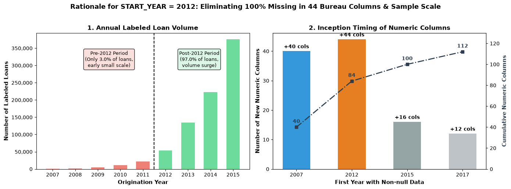{width=95%}

- **Trái:** số khoản vay có nhãn theo năm đến 2015; cột đỏ = trước 2012 (rất ít), xanh = từ 2012 trở đi. Pre-2012 chỉ 2.96% số khoản có nhãn.
- **Phải:** số cột số xuất hiện dữ liệu lần đầu mỗi năm (cột) và tích lũy (đường). Năm 2012 có thêm 44 cột bureau.
- **Kết luận:** chọn 2012: mất < 3% khoản nhưng 44 cột không bị trống.

### Biểu đồ số khoản vay và tỷ lệ vỡ nợ theo tháng phát hành
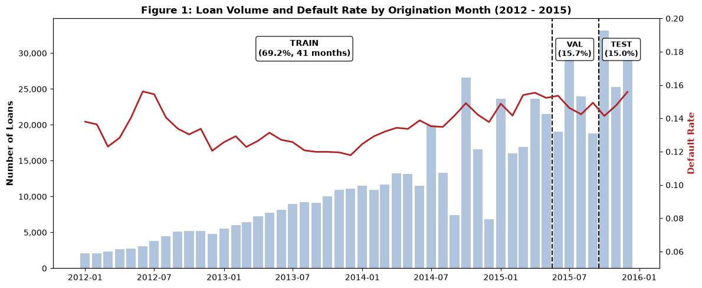{width=95%}

- Cột = số khoản/tháng; đường đỏ = tỷ lệ vỡ nợ; hai đường đứt = hai điểm cắt train|val và val|test (giữa hai tháng để không cắt ngang tháng).
- Tháng nhiều nhất: 2015-10 (33,186 khoản). Số khoản tăng mạnh theo thời gian nên dù train dài 41 tháng, val/test chỉ 4 và 3 tháng.
- Tỷ lệ vỡ nợ nhích lên → trôi dạt (13.7% → 14.8%).

### Bảng tỷ lệ có kết cục theo năm
Dùng ở slide 5: cho thấy vì sao phải có quy tắc đáo hạn. Cột `term_60_share` cho thấy tỷ lệ khoản 60 tháng (18.5%–35.1% giai đoạn 2010–2018).

### Bảng kiểm chứng quy tắc đáo hạn
Matured: 676,459 khoản, 99.6% có kết cục, vỡ nợ 14.8%, 8.2% là 60 tháng. Unmatured: 1,584,242, 42.4% có kết cục. Nếu luật đúng thì nhóm matured phải gần 100% → đúng. Lưu ý 25.1% vỡ nợ của nhóm chưa đáo hạn chỉ tính trên khoản *tình cờ đã có nhãn* nên thiên lệch (khoản vỡ nợ sớm có nhãn sớm).

## 3.2 Notebook 02

### Cân bằng nhãn và tỷ lệ vỡ nợ theo tập
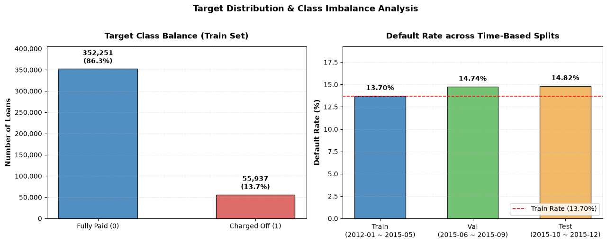{width=95%}

- **Trái:** nhãn trên train: 86.3% trả đủ, 13.7% vỡ nợ (mất cân bằng vừa phải, không quá lệch).
- **Phải:** tỷ lệ vỡ nợ 13.70% / 14.74% / 14.82% theo train/val/test; đường đỏ = mức train.
- **Ý nghĩa:** mô hình sẽ gặp tỷ lệ vỡ nợ cao hơn lúc huấn luyện → tại sao chỉ dùng thước đo xếp hạng (không phụ thuộc tỷ lệ nền).

### Tỷ lệ thiếu dữ liệu của 151 cột
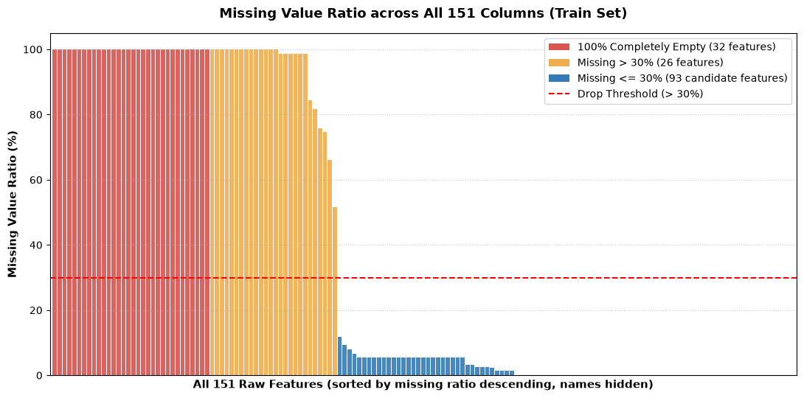{width=85%}

- Mỗi cột đứng = một cột dữ liệu, sắp giảm dần theo % thiếu; đỏ = trống 100%, vàng = thiếu >30%, xanh = ≤30%; đường đứt = ngưỡng loại 30%.
- 32 cột trống hoàn toàn, 26 cột thiếu 30%–<100%, 93 cột thiếu ≤30%.
- **Việc đã làm:** loại cột thiếu >30% (58 cột gồm cả cột trống), điền trung vị cho cột thiếu ≤30%.

### Tỷ lệ vỡ nợ theo mục đích vay
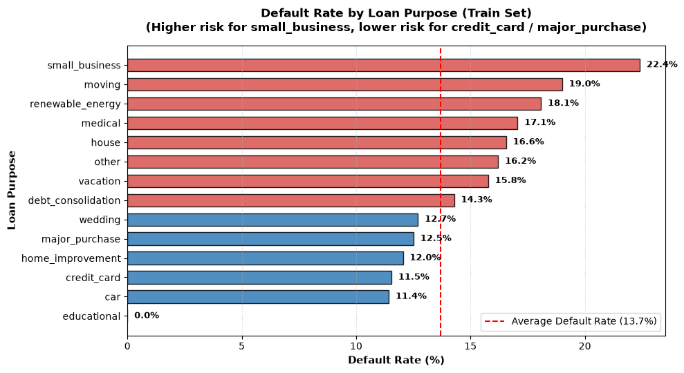{width=85%}

- Thanh đỏ = cao hơn mức trung bình 13.7%, xanh = thấp hơn. Cao nhất: `small_business` 22.4%; thấp: `car` 11.4%, `credit_card` 11.5%.
- `educational` = 0.0% — notebook không in số khoản nên đừng giải thích (có thể rất ít khoản).
- Kết luận: `purpose` có tín hiệu → giữ làm biến phân loại (`purpose_small_business` có hệ số +0.311).

### Phân 151 cột thành 8 nhóm quy tắc
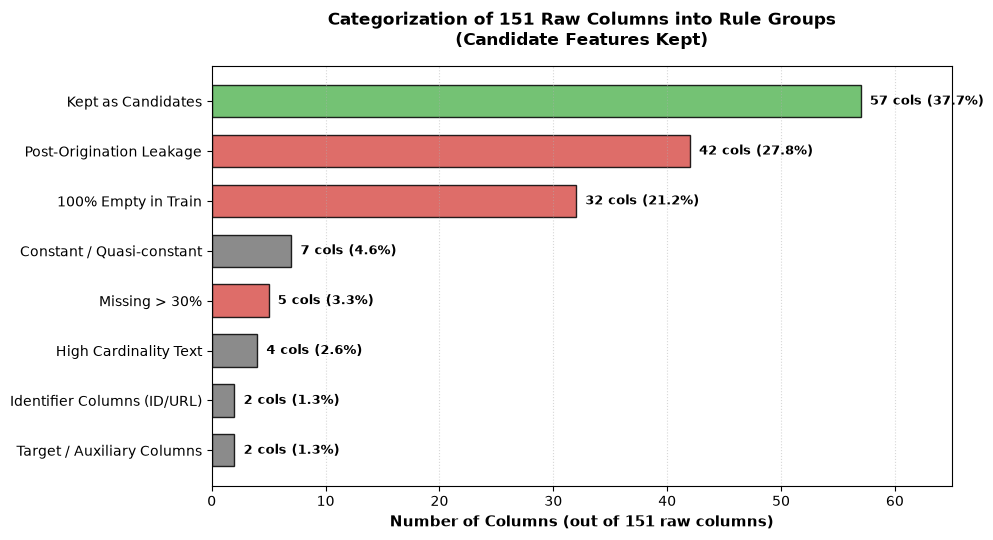{width=85%}

Thanh xanh = 57 cột được giữ (37.7%); đỏ = nhóm loại vì rò rỉ/trống/thiếu; xám = nhóm loại khác. Là bản hình của slide 8.

### Phân phối FICO và loan-to-income: trả đủ vs vỡ nợ
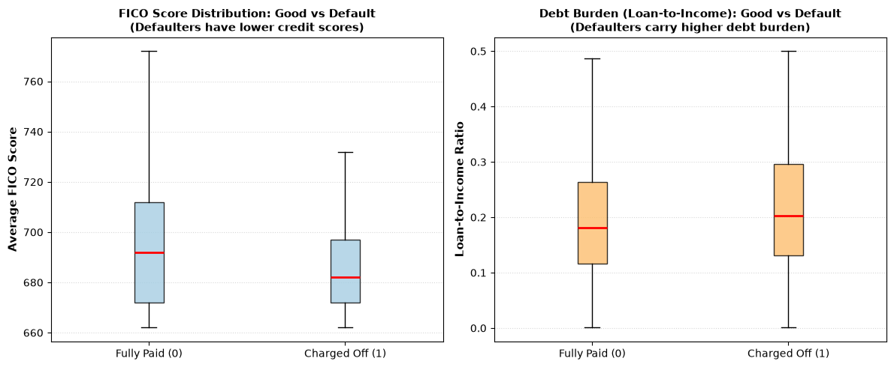{width=90%}

Hộp = khoảng tứ phân vị, vạch đỏ = trung vị, râu = khoảng thường, ngoại lai bị ẩn. Nhóm vỡ nợ có FICO trung vị thấp hơn (khoảng 682 so với 692, đọc từ hình) và loan-to-income trung vị cao hơn (khoảng 0.20 so với 0.18). Dấu hiệu hai biến này có tín hiệu.

### Top 15 đặc trưng số theo AUC đơn cột
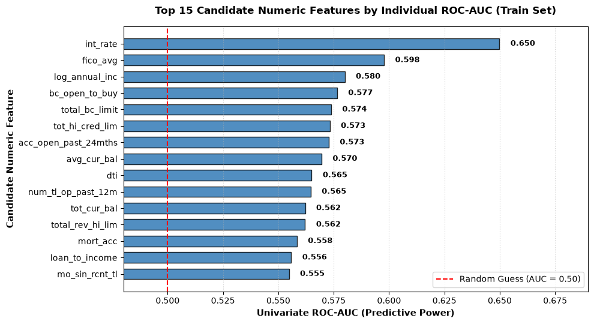{width=85%}

Thanh = AUC của từng biến đứng một mình trên train; đường đỏ = 0.5. Cao nhất: `int_rate` 0.650 (đã loại sau đó vì do Lending Club đặt theo grade), `fico_avg` 0.598, `log_annual_inc` 0.580. Không biến số nào đơn lẻ vượt 0.6565 của `sub_grade` → cần kết hợp nhiều tín hiệu yếu.

### Tỷ lệ vỡ nợ theo 10 phân vị (decile) của 6 biến
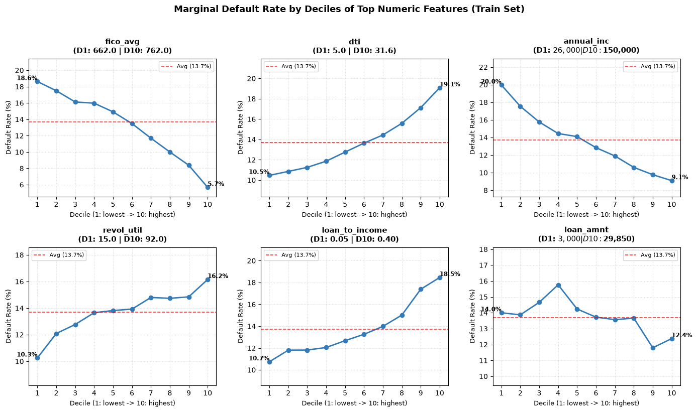{width=100%}

Trục x: decile 1 (thấp nhất) → 10 (cao nhất); trục y: tỷ lệ vỡ nợ; đường đỏ đứt = 13.7%. Đọc:

- `fico_avg`: 18.6% → 5.7% (giảm đơn điệu), `annual_inc`: 20.0% → 9.1% (giảm).
- `dti`: 10.5% → 19.1%, `revol_util`: 10.3% → 16.2%, `loan_to_income`: 10.7% → 18.5% (tăng).
- `loan_amnt` **không đơn điệu**: đỉnh 15.7% ở decile 4 rồi giảm về 12.4% → mô hình tuyến tính không bắt được; đây là lý do hợp lý để thử mô hình phi tuyến.
- (Ký hiệu $ trong tiêu đề bị matplotlib hiển thị như công thức toán — lỗi hiển thị, không ảnh hưởng số.)

### Ma trận tương quan Pearson
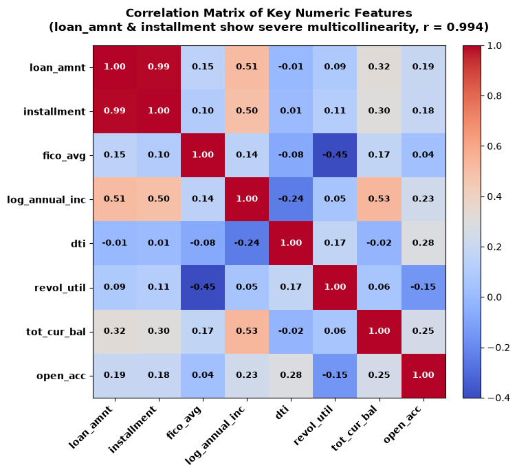{width=70%}

Màu đỏ đậm = tương quan dương mạnh. Điểm nhấn: `loan_amnt` – `installment` r = 0.994 (gần như trùng nhau, vì trả góp hằng tháng ≈ số vay/kỳ hạn) → loại `installment`. Có 5 cặp |r| ≥ 0.90: (`open_acc`, `num_sats`) 0.9987; (`loan_amnt`, `installment`) 0.9941; (`num_actv_rev_tl`, `num_rev_tl_bal_gt_0`) 0.9903; (`tot_cur_bal`, `tot_hi_cred_lim`) 0.9744; (`mo_sin_old_rev_tl_op`, `credit_history_years`) 0.9245.

### Tỷ lệ vỡ nợ theo 35 sub_grade
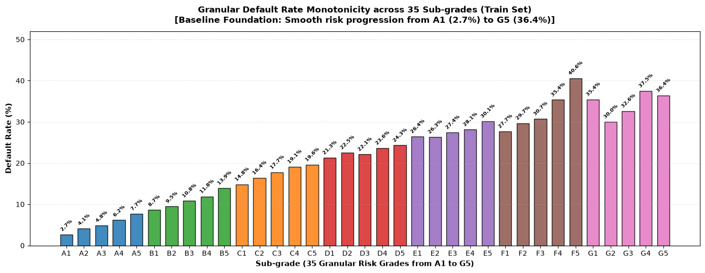{width=100%}

Mỗi cột một sub_grade, từ A1 (2.7%) đến G5 (36.4%), màu theo grade A–G. Tăng đều → `sub_grade` là tín hiệu rủi ro mạnh và có thứ tự → là baseline hợp lý và cũng là lý do hệ số của nó lấn át (thí nghiệm 1).

### Lãi suất theo grade
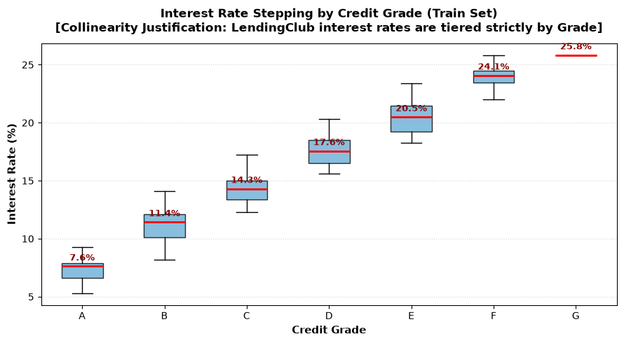{width=75%}

Hộp lãi suất theo grade A–G, tăng dần theo grade → Lending Club *định giá lãi suất theo grade*, vì vậy `int_rate` về bản chất lặp lại thông tin của grade → loại `int_rate` (và `grade` vì đã nằm trong sub_grade).

### Skewness và Mean/Median của các cột có thiếu
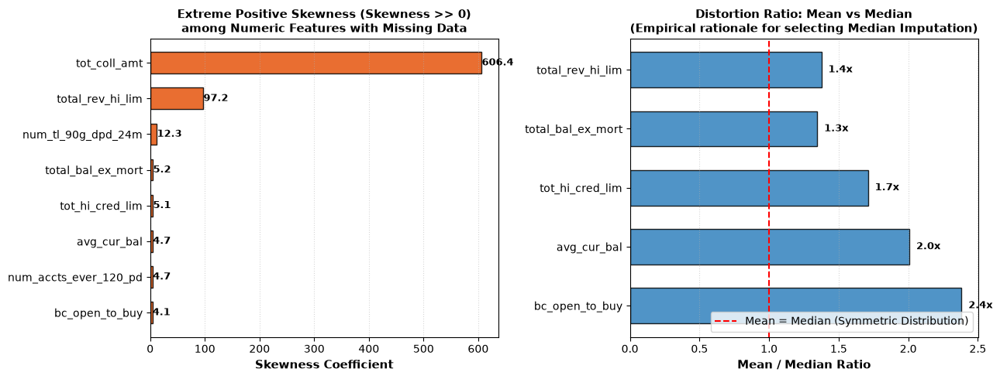{width=95%}

Trái: skewness cực cao (ví dụ `tot_coll_amt` 606.4, `total_rev_hi_lim` 97.2). Phải: tỷ lệ Mean/Median > 1 cho thấy mean bị kéo lên. Cơ sở chọn điền trung vị.

### So sánh điền Median và điền Mean (`total_rev_hi_lim`)
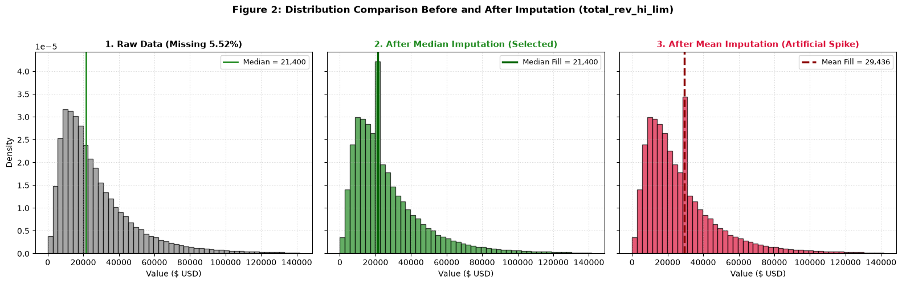{width=100%}

Trái: phân phối gốc (xám) + đường median. Giữa: sau điền median — phân phối giữ nguyên hình dạng. Phải: sau điền mean — xuất hiện cột nhọn nhân tạo ở giá trị mean (xa trung tâm số đông). Dùng đồ thị này để biện hộ cho "tại sao median, không phải mean".

### Thang đo trước và sau StandardScaler
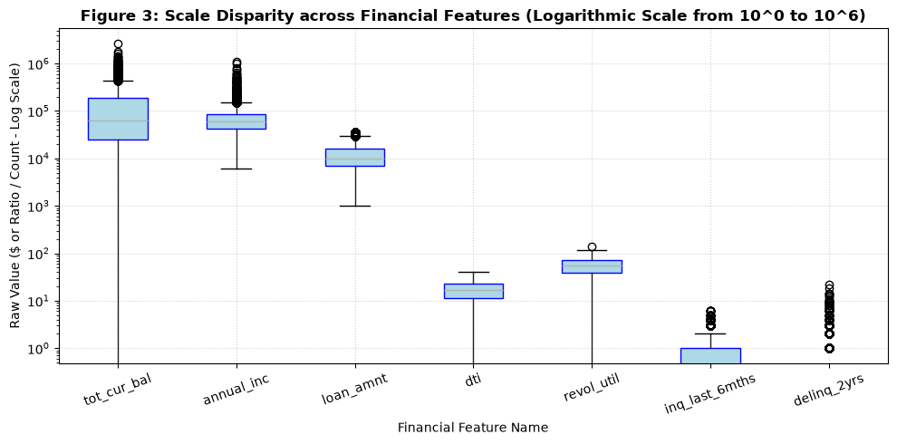{width=80%}
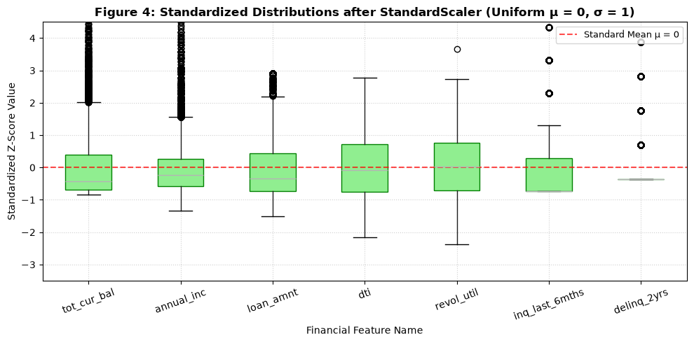{width=80%}

Trước: trục log, các biến từ ~0.3 đến >100,000 → chênh > 10^5 lần. Sau: tất cả quy về trung bình ≈ 0 (max |μ| = 5.07e-16) và σ ≈ 1. Để phạt L2 công bằng và so sánh hệ số.

### Các bảng khác của notebook 02
- *Bảng vi phạm quy tắc logic trước/sau làm sạch:* `revol_util > 100` còn lại vì hợp lệ; các quy tắc khác về 0.
- *Bảng 31 cột số bị thiếu:* số dòng thiếu, % thiếu, skewness, mean, median.
- *Bảng thống kê ma trận sau biến đổi:* train có trung bình ≈ 0, độ lệch chuẩn ≈ 1; val có trung bình lệch tối đa 0.162 vì dùng thống kê của train — đúng thiết kế, bằng chứng không rò rỉ.
- *Kiểm tra pipeline tái lập:* fit lần hai ra ma trận val giống hệt.

## 3.3 Notebook 03

### So sánh ROC và ba thước đo trên validation
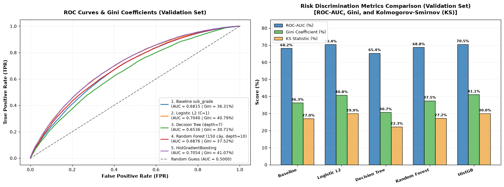{width=100%}

- **Trái:** đường ROC của 5 mô hình (kèm AUC, Gini); đường chéo = ngẫu nhiên. Logistic và HistGB gần như chồng nhau, cao nhất; cây thấp nhất.
- **Phải:** cột nhóm ROC-AUC / Gini / KS (%) theo mô hình. Gini = 2×AUC − 1 nên ở thang %, AUC 70.4% ↔ Gini 40.8% (cùng một thông tin, khác thang).

### Đường tách biệt tích lũy KS
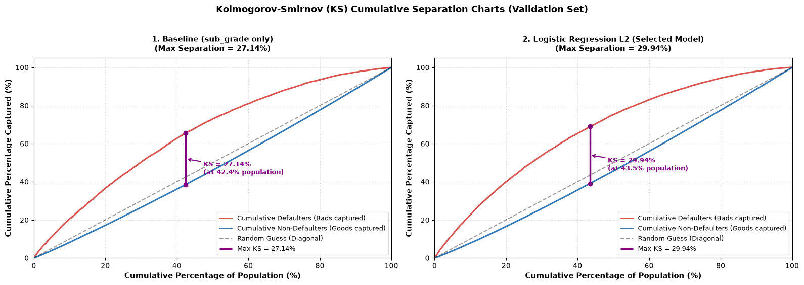{width=100%}

Trục x: % tập khoản vay sắp xếp từ điểm rủi ro cao → thấp; trục y: % tích lũy của nhóm vỡ nợ (đỏ) và nhóm trả đủ (xanh). Đường tím dọc là khoảng cách lớn nhất = KS. Baseline KS 27.02%; Logistic 29.94%. Khoảng cách càng lớn thì hai nhóm càng tách.

### Các bảng chỉnh tham số
- Logistic: CV AUC 0.6855 (C=1), 0.6854 (C=10), 0.6853 (0.1), 0.6839 (0.01), 0.6782 (0.001) → phẳng từ C ≥ 0.1; phạt quá mạnh mới tệ.
- Cây: depth 7 tốt nhất (0.6355); depth 3: 0.6139, depth 10: 0.6278 → đường cong hình chuông (quá nông thiếu khả năng, quá sâu học thuộc).
- RF: 9 tổ hợp tốt nhất đều depth 10 (0.6720–0.6741) → chạm biên lưới.
- HistGB: 10 tổ hợp đầu cách nhau 0.0018 (0.6852–0.6834) → chênh lệch rất nhỏ.

## 3.4 Thí nghiệm

### ROC và cột thước đo khi bỏ `sub_grade` (hình có nhãn tiếng Việt)
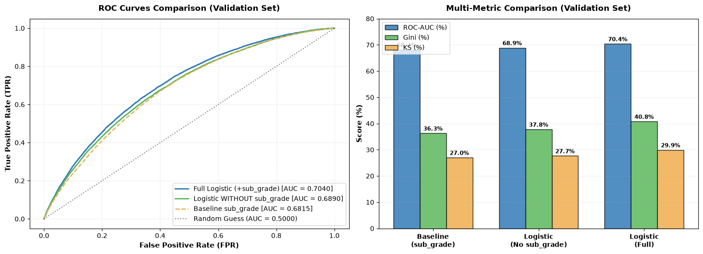{width=100%}

Ba đường: Logistic đầy đủ (xanh dương, cao nhất), Logistic bỏ sub_grade (xanh lá, giữa), Baseline (cam đứt). Panel phải: AUC/Gini/KS của ba mô hình. "BỎ" = bỏ, "Đầy đủ" = full.

### Dịch chuyển hệ số
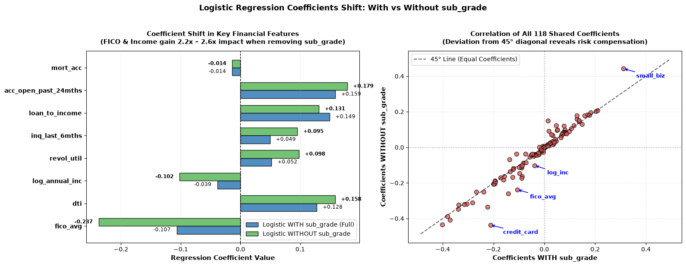{width=100%}

- **Trái:** 8 biến chủ chốt; thanh xanh dương = hệ số có sub_grade, xanh lá = không có. Các biến FICO và thu nhập có thanh dài ra rõ → "tái phân bổ trọng số".
- **Phải:** 118 hệ số chung: mỗi chấm = một đặc trưng, trục x hệ số khi có sub_grade, trục y khi không có; đường chéo 45° = không đổi. Chấm nằm xa đường chéo = hệ số đổi nhiều.

### Phân phối điểm tín dụng và trọng số scorecard
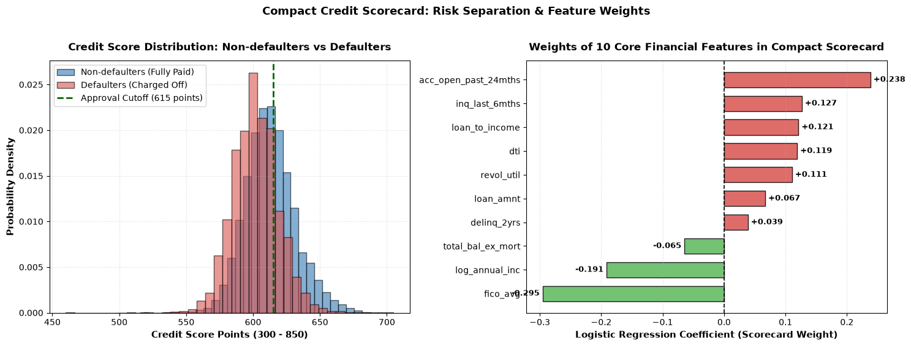{width=100%}

- **Trái:** mật độ điểm của khoản trả đủ (xanh) và vỡ nợ (đỏ) trên test; vạch xanh lá = điểm 615 (ví dụ ngưỡng duyệt). Nhóm vỡ nợ lệch về điểm thấp hơn; hai phân phối vẫn chồng nhau nhiều (AUC chỉ 0.673).
- **Phải:** trọng số của 10 biến số: đỏ = tăng rủi ro, xanh = giảm rủi ro (FICO, thu nhập giảm rủi ro; số tài khoản mở 24 tháng, số lần tra cứu, tỷ lệ vay/thu nhập... tăng rủi ro).

### Bảng phân tầng rủi ro theo điểm (val và test)
| Dải điểm | Val: số khoản | Val: vỡ nợ | Test: số khoản | Test: vỡ nợ |
|---|---|---|---|---|
| < 590 | 11,279 | 29.38% | 10,145 | 30.18% |
| 590–614 | 44,394 | 17.08% | 42,171 | 17.28% |
| 615–639 | 30,379 | 8.32% | 29,671 | 8.66% |
| ≥ 640 | 6,579 | 3.45% | 6,682 | 3.26% |

Cách nói: "ngưỡng được cố định từ val rồi áp nguyên cho test; tỷ lệ vỡ nợ từng nhóm gần như giữ nguyên, cho thấy điểm số xếp hạng bền theo thời gian."

---

# 4. Hỏi đáp dự kiến

**1. Bài toán là gì, vì sao quan trọng?** Xếp hạng khoản vay theo xác suất vỡ nợ lúc xét duyệt để quyết định cho vay/định giá. Điểm khó là rò rỉ dữ liệu, thời gian, và đã có sẵn grade của nền tảng.

**2. Sao không chia train/test ngẫu nhiên?** Ngẫu nhiên cho mô hình "thấy tương lai" khi dự đoán quá khứ; thực tế luôn dự đoán khoản vay sau. Chia theo thời gian cho ước lượng trung thực hơn, đồng thời lộ rõ trôi dạt (tỷ lệ vỡ nợ 13.7% → 14.8%).

**3. Val dùng để làm gì, test để làm gì?** Hyperparameter tuning làm *trong train* bằng TimeSeriesSplit. Val dùng để so sánh mô hình, đo overfitting, tính bootstrap CI. Test chỉ dùng một lần cuối cho baseline, Logistic, HistGB.

**4. Vì sao chọn Logistic dù HistGB cao hơn chút?** HistGB 0.7054 vs Logistic 0.7040 trên val; CI của hiệu [−0.0002, +0.0031] chứa 0, test lệch 0.0016. Không phân biệt được nên chọn mô hình đơn giản, nhanh, giải thích từng hệ số. Đây là phán đoán, không phải kết quả thống kê.

**5. AUC 0.70 có cao không?** Không "đẹp", nhưng với dữ liệu tại thời điểm xét duyệt và đã loại rò rỉ, đây là mức hợp lý; baseline sub_grade cũng chỉ 0.68. Không so số của project này với số của paper/repo khác vì khác dữ liệu, bộ lọc, cách chia.

**6. Cải thiện +0.022 AUC có ý nghĩa không?** Về thống kê: có (CI [+0.0196, +0.0253] không chứa 0). Về kinh doanh: chưa quy đổi ra tiền; nói rõ chưa phân tích chi phí.

**7. Vì sao bỏ `int_rate` và `grade` nhưng giữ `sub_grade`?** `grade` là thông tin thô của `sub_grade` (A vs A1–A5); `int_rate` Lending Club đặt theo grade (hình lãi suất theo grade). Giữ `sub_grade` làm tín hiệu mạnh nhất; thí nghiệm 1 trả lời điều gì xảy ra nếu bỏ nó.

**8. `sub_grade` có phải rò rỉ không?** Nó gán lúc niêm yết khoản vay nên biết lúc xét duyệt, không rò rỉ. Nhưng nó là *đầu ra của mô hình của Lending Club*, nên đưa vào là "cải tiến trên mô hình có sẵn", bỏ ra là "thay thế mô hình có sẵn".

**9. Vì sao chỉ khoản 36 tháng?** Với luật đáo hạn, khoản 60 tháng không có ở 2015 → lệch cơ cấu kỳ hạn giữa train và test. Hệ quả: kết quả không khái quát cho 60 tháng.

**10. Sao điền trung vị thay vì trung bình? Sao StandardScaler?** Xem 1.5 và hai biểu đồ skew/imputation/scale: 28/31 cột thiếu lệch phải; mean của `avg_cur_bal` cao hơn median 100.7%; thang đo chênh >10^5 lần ảnh hưởng phạt L2.

**11. Điền median 5–30% thiếu có làm lệch không?** Có thể — 26 cột thiếu 5–30%, đều bắt đầu ghi từ 2012; không thêm biến chỉ báo "đã bị thiếu" và chưa kiểm tra xem thiếu có mang thông tin. Đã ghi là hạn chế.

**12. Tại sao loại các cột `mths_since_...`?** Thiếu > 30% trong train. Nhưng thiếu có thể nghĩa "chưa từng xảy ra" nên mất thông tin; hướng phát triển: dùng biến chỉ báo.

**13. Vì sao bootstrap, không dùng p-value?** Bootstrap cho CI trực tiếp của hiệu AUC (khó có công thức đóng) và dễ diễn giải. Bootstrap *paired* (cùng mẫu cho cả hai mô hình) trừ bớt nhiễu chung. Hạn chế: chỉ phản ánh nhiễu mẫu val.

**14. Vì sao bootstrap không chạy trên test?** Chưa làm; hướng phát triển.

**15. TimeSeriesSplit khác K-fold thế nào?** Xem 1.3. K-fold xáo trộn học trên tương lai của phần kiểm tra.

**16. Tại sao Random Forest overfit?** Chênh lệch Train−Val +0.0184 (lớn nhất). Một giả thuyết: cây sâu học nhiễu train; nhưng lưới chạm biên depth 10 nên chưa chắc đã tối ưu.

**17. Tại sao Val AUC > Train AUC ở baseline và Logistic?** Không biết. Chỉ thấy rằng giai đoạn val dễ xếp hạng hơn giai đoạn train với hai mô hình này. Chưa kiểm tra giả thuyết (ví dụ độ tách của sub_grade thay đổi theo thời gian). Đừng bịa nguyên nhân.

**18. Lưới tham số chạm biên là sao?** RF chọn depth 10 và 150 cây (giá trị lớn nhất lưới); HistGB depth 10, 150 vòng, lr 0.05 (biên). Lân cận chênh ~0.001 AUC. Có thể còn tốt hơn nếu mở rộng lưới.

**19. Có xử lý mất cân bằng lớp không (SMOTE, trọng số)?** Không. Tỷ lệ vỡ nợ 13.7% là mất cân bằng vừa; AUC/Gini/KS không phụ thuộc tỷ lệ nền; không cần ngưỡng cố định.

**20. Xác suất ra có hiệu chuẩn (calibrated) không?** Chưa kiểm tra (không có biểu đồ calibration hay Brier score); chỉ dùng điểm để xếp hạng. Tỷ lệ vỡ nợ thực tế ở các dải điểm scorecard cho thấy xếp hạng bền nhưng đó không phải calibration xác suất.

**21. Vì sao chỉ L2, không L1 hay không phạt?** Chọn L2 vì xử lý tương quan nhóm biến tốt và giữ hết biến để so sánh hệ số; L1 (chọn biến thưa) và logistic không phạt chưa thử — hướng mở rộng.

**22. Hệ số Logistic đọc thế nào?** Đã chuẩn hóa → mỗi hệ số là thay đổi log-odds trên 1 độ lệch chuẩn (biến số) hoặc so với nhóm còn lại (one-hot). Dương = tăng rủi ro. Chỉ là tương quan, không phải nhân quả.

**23. Vì sao scorecard thấp hơn baseline mà vẫn trình bày?** Để nói thẳng đánh đổi: ít biến hơn (30 cột thay vì 153) thì mất ~0.031 AUC so với mô hình đầy đủ và ~0.009 so với baseline; hữu ích khi tổ chức *không có* grade hoặc muốn ít dữ liệu đầu vào.

**24. Cắt điểm 590/615/640 chọn thế nào, có rò rỉ không?** Chọn từ phân phối điểm trên val rồi áp nguyên cho test, không tinh chỉnh trên test. Nhưng test được dùng để mô tả trong thí nghiệm này (không dùng để chọn mô hình).

**25. Test có thật sự chỉ dùng một lần?** Trong notebook 03 thì có (tính chung cho baseline, Logistic, HistGB). Hai notebook thí nghiệm cũng in chỉ số test để mô tả, nhưng không đổi lựa chọn mô hình.

**26. Có công bằng/pháp lý (dùng `addr_state`) không?** Chưa phân tích disparate impact. Ghi nhận là giới hạn.

**27. Có dữ liệu bị từ chối (rejected) không?** File dùng chỉ gồm khoản được chấp nhận → thiên lệch chọn mẫu, chưa xử lý (reject inference).

**28. Làm sao tái lập kết quả?** SEED = 42, notebook chạy từ đầu đến cuối, manifest chia dữ liệu có MD5 của id train `8ce37fef31257778922ffe920c32511c`, pipeline lưu bằng joblib. File Kaggle gốc bắt buộc, không dùng dữ liệu giả.

**29. Đóng góp của bạn là gì?** Quy trình nghiêm ngặt: kiểm chứng rò rỉ bằng dữ liệu, chia OOT, baseline sub_grade, so sánh có CI, ablation và scorecard; kết quả không như kỳ vọng được nêu thẳng.

**30. Hướng phát triển?** Mở rộng lưới tìm kiếm, nhiều cửa sổ test, kiểm tra dataset shift (adversarial validation), biến chỉ báo cho dữ liệu thiếu, calibration, ngưỡng theo chi phí, khoản vay 60 tháng bằng phân tích sống còn, công bằng.

---

# 5. Những chỗ slide KHÔNG khớp notebook (sửa trước khi thuyết trình)

| # | Trên slide | Notebook/output hiện tại | Nên làm |
|---|---|---|---|
| 1 | Slide 11: HistGB − Logistic CI **[−0.0004, +0.0031]** | Output notebook 03: **[−0.0002, +0.0031]** | Sửa slide cho khớp output (kết luận "chứa 0" không đổi) |
| 2 | Slide 13: "≈ 96% of full model power" | Notebook đã in **84.8%** (tỷ lệ Gini 34.60% / 40.79%). Con số 96% tương ứng 0.6730/0.7039 — tỷ lệ AUC, không có nghĩa vì AUC ngẫu nhiên là 0.5 | Đổi thành 84.8% (theo Gini) |
| 3 | Slide 13: score range **460 – 705** | Output notebook: val **494 – 757** | Sửa hoặc bỏ dòng này |
| 4 | Slide 9 (DETAILS): `loan_to_income` cap **0.515**, "skew 36.74 → 0.19" | Output notebook hiện tại: cap **0.5**; skewness 36.74 → 0.19 không có trong output đã xem | Sửa cap thành 0.5; kiểm tra lại skewness trong notebook rồi mới nói |
| 5 | Slide 9 (DETAILS): "mean above median **+10% đến +138%**" | Notebook in chuỗi "+35% đến +138%"; bảng 31 cột có cột lệch ít hơn thế (ví dụ `num_tl_op_past_12m` −1.2%) | Chỉ nói "lên đến +138%" |
| 6 | Slide 10 (DETAILS): "Val higher than train comes from sample change between quarters" | Nguyên nhân **chưa được kiểm chứng** | Đổi thành "quan sát được, chưa giải thích" |
| 7 | Slide 9: liệt kê 6 feature mới | `credit_history_years` bị loại sau đó vì tương quan 0.9245; mô hình cuối chỉ có 5 feature tự tạo | Ghi chú thêm |
| 8 | Slide 13 tiêu đề phụ: "12 core features… 300 – 850 style score" | Điểm thực tế chỉ nằm trong khoảng ~494–757 | Nói rõ thang 300–850 chỉ là biên kẹp |

Ngoài ra, một số câu nhận xét gõ tay trong notebook 02 không khớp output (ví dụ "AUC rò rỉ 0.85–0.99" trong khi cao nhất là 0.907; "50 trường (153 biến)" ở thí nghiệm 2). Nếu thầy mở notebook, hãy nói theo con số **in ra**, không theo câu gõ tay.
